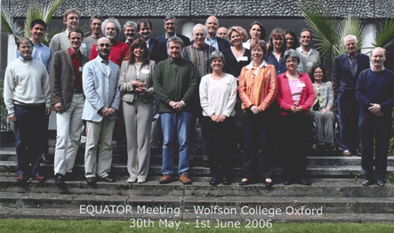
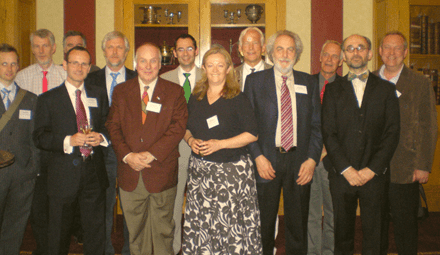

## History

The EQUATOR programme grew out of the work of CONSORT and other guideline
development groups. The **project** **began in March 2006**. Initially
funded for one year by the UK NHS National Knowledge Service, the project
had three major objectives: to map the current status of all activities
aimed at preparing and disseminating guidelines on reporting health
research studies, identify key individuals working in the area, and
establish relationships with potential key stakeholders.

The EQUATOR Network held its **first international working meeting** in
Oxford in May-June 2006, attended by 27 participants from 10 countries. The
participants included representatives of reporting guideline development
groups, journal editors, peer reviewers, medical writers and funders. The
objective of the meeting was to exchange experience in developing, using
and implementing reporting guidelines and outline priorities for the future
EQUATOR Network activities.

{fig-align="center" width="443"}

Before the first EQUATOR meeting, we searched the literature to identify
published reporting guidelines and surveyed authors to examine how the
guidelines were developed and to identify problems encountered during their
development (see [Simera et al, PLoS Med
2008](https://journals.plos.org/plosmedicine/article?id=10.1371/journal.pmed.0050139 "PLoS")).
The survey results and meeting discussions helped us to prioritise the main
activities for a successful start to the EQUATOR Network’s efforts to
improve the quality of reporting of health research.

The EQUATOR Network was officially launched at its **inaugural meeting in
London** in June 2008.

{fig-align="center"}

Since its launch, the programme has already achieved [important
milestones](equator-network.qmd).

The EQUATOR Network has opened national centres to contribute to expanding
EQUATOR activities. These centres focus on national activities aimed at
raising awareness and supporting good research reporting practices. The
centres work with partner organisations and initiatives, and also
contribute to the work of the EQUATOR Network as a whole. In 2014 we
launched the [UK EQUATOR Centre](uk-equator-centre.qmd), [French EQUATOR
Centre](international-equator-centres.html#french-equator-centre) and
[Canadian EQUATOR
Centre](international-equator-centres.html#canadian-equator-centre). The
[Australasian EQUATOR
Centre](international-equator-centres.html#australasian-equator-centre)
followed in 2016 and the [Chinese EQUATOR
Centre](international-equator-centres.html#chinese-equator-centre) was
launched in 2021.
