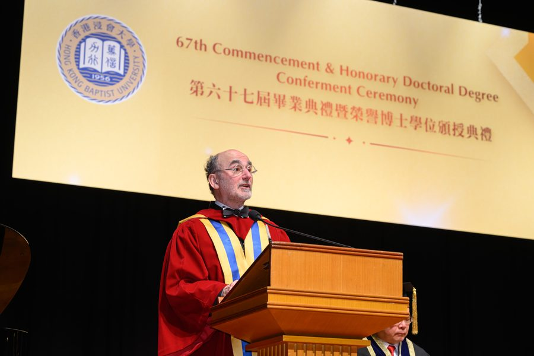
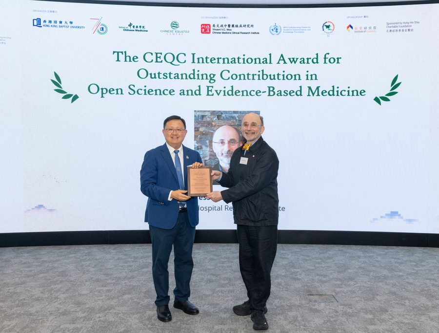

At the 67th Commencement of Hong Kong Baptist University (HKBU) on 16 November 2026, Professor [David Moher](/about/people/dmoher.qmd) received an Honorary Doctor of Science in recognition of his global leadership and capacity-building in scholarly guidance, results reporting, and transparent health research. Speaking on behalf of the honorary degree recipients, he highlighted how research transparency enables people to scrutinise and benefit from research findings. He also encouraged graduates to remain curious, think critically and use their knowledge with integrity in the service of the wider community.

{width=55% fig-align="center" fig-alt="Professor David Moher speaking at the HKBU commencement ceremony"}

Professor David Moher, Senior Scientist at the Ottawa Hospital Research Institute and Director of the [Canadian EQUATOR Centre](/about/international-equator-centres.qmd#canadian-equator-centre), has made leading contributions to the development and advancement of [CONSORT](/reporting-guidelines/consort/) (CONsolidated Standards of Reporting Trials) guidance and [PRISMA](/reporting-guidelines/prisma/) (Preferred Reporting Items for Systematic Reviews and Meta-Analyses) guidance, helping to improve the completeness and transparency of health research reporting.

## Inaugural CEQC International Award

The day before (15 November), Professor Moher received the inaugural CEQC International Award for Outstanding Contribution in Open Science and Evidence-Based Medicine. Established by the [Chinese EQUATOR Centre](/about/international-equator-centres.qmd#chinese-equator-centre) (CEQC) at HKBU, the award recognises outstanding contributions to open science and evidence-based medicine. Following a nomination and voting process, the award committee selected Professor David Moher and Professor Youping Li (from Sichuan University, China), a pioneer in evidence-based medicine in China, as joint recipients.

{width=55% fig-align="center" fig-alt="Dr Kennedy Y H Wong presenting the CEQC International Award to Professor David Moher"}

The award was presented at the Evidence-Based Medicine and Reporting Guidelines International Conference and CONSORT Statement 30th Anniversary Celebration, held in Hong Kong on 15 November. Organised by CEQC, the conference brought together international scholars, clinicians, journal editors and policymakers under the theme "From Evidence to Impact: Strengthening Reproducibility and Transparency in Health Research".

Following the award presentation, Professor Moher delivered a keynote lecture titled "The Evolution of Reporting Guidelines and the CONSORT Experience". He also joined an interactive dialogue moderated by Professor [Zhaoxiang Bian](/about/people/zbian.qmd), Director of the CEQC. The discussion explored how clinical trial reporting has changed over the past 30 years, the responsibilities of interest-holders in promoting complete reporting, as well as the potential role of artificial intelligence in developing and overseeing reporting guidelines.

## Video

[Award Recipient: Prof. David Moher – Contributions to Open Science and Evidence-Based Medicine](https://drive.google.com/file/d/1wOdG-newWDlMY_vdc8MhjeE8gpwwL7L8/view?usp=drive_link) (opens on Google Drive; download to view).
