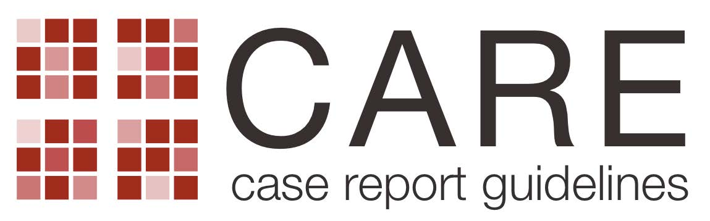

```{=html}
<style>
  #tp-wrap { --accent:#9c2631; --box:#fbf1f2; --boxline:#d9a3a9; --line:#000;
    font-family:Arial,Helvetica,sans-serif; color:#111; max-width:1000px; margin:0 auto; }
  #tp-wrap .tp-top { display:flex; align-items:center; gap:1.2rem; flex-wrap:wrap; margin-bottom:.8rem; }
  #tp-wrap .tp-top .logo { width:min(190px,35%); height:auto; flex:none; }
  #tp-wrap .tp-title { font-size:18px; font-weight:bold; line-height:1.3; flex:1 1 260px; }
  #tp-wrap .tp-badges { display:flex; align-items:center; gap:.8rem; flex:none; }
  #tp-wrap .tp-badges .cc { width:80px; height:auto; } #tp-wrap .tp-badges .chk { width:34px; height:auto; }
  #tp-wrap .tp-meta { font:14px Arial,sans-serif; margin:.4rem 0 .8rem; }
  #tp-wrap .tp-meta label { display:flex; align-items:center; gap:.5rem; width:100%; font-weight:bold; }
  #tp-wrap .tp-meta input { flex:0 1 50%; min-width:0; font:14px Arial,sans-serif; font-weight:normal; padding:.35rem .5rem;
    border:1.5px solid var(--boxline); background:var(--box); border-radius:3px; }
  #tp-wrap .tp-meta input:focus { outline:2px solid var(--accent); background:#fff; }
  #tp-wrap table { border-collapse:collapse; width:100%; font-size:13.5px; line-height:1.35; }
  #tp-wrap th, #tp-wrap td { border:0; padding:6px 8px; vertical-align:middle; text-align:left; }
  #tp-wrap thead th { background:var(--accent); color:#fff; font-weight:bold; font-size:14px; }
  #tp-wrap td.topic { width:19%; font-weight:bold; vertical-align:top; }
  #tp-wrap td.item { width:6%; font-weight:bold; vertical-align:middle; }
  #tp-wrap th.pgh, #tp-wrap td.pg { width:17%; }
  #tp-wrap td.pg { padding:3px 8px; }
  #tp-wrap td.pg input[type=text] { width:100%; box-sizing:border-box; border:1.5px solid var(--boxline); border-radius:3px; background:var(--box);
    text-align:center; font:14px Arial,sans-serif; padding:6px 2px; }
  #tp-wrap td.pg input[type=text]:hover { border-color:var(--accent); }
  #tp-wrap td.pg input[type=text]:focus { outline:2px solid var(--accent); background:#fff; }
  #tp-wrap td.yn { font-weight:bold; white-space:nowrap; }
  #tp-wrap td.yn label { margin-right:.8rem; cursor:pointer; }
  #tp-wrap td.yn input { width:17px; height:17px; vertical-align:-3px; accent-color:var(--accent); }
  #tp-wrap input::placeholder { color:#9a6a70; font-size:12px; }
  #tp-wrap .tp-hint { display:block; font-weight:normal; font-size:11px; }
  /* Equator logo: hidden on screen, shown only in the saved PDF (print) */
  #tp-wrap .tp-eqrow { display:none; }
  #tp-wrap .tp-eq { width:150px; height:auto; }
  .tp-actions { display:flex; gap:.6rem; flex-wrap:wrap; margin:1rem 0 1.4rem; }
  .tp-actions button { font:600 15px Arial,sans-serif; padding:.55rem 1.1rem; border-radius:4px; cursor:pointer;
    border:2px solid #9c2631; background:#9c2631; color:#fff; }
  .tp-actions button.alt { background:#fff; color:#9c2631; }
  .tp-actions button:focus-visible { outline:3px solid #f3b800; outline-offset:2px; }
  .tp-note { font:14px Arial,sans-serif; color:#444; margin:0; flex-basis:100%; }

  @media print {
    @page { size:A4 portrait; margin:12mm; }
    body * { visibility:hidden; }
    #tp-wrap, #tp-wrap * { visibility:visible; }
    #tp-wrap { position:absolute; left:0; top:0; width:100%; max-width:none; }
    .tp-actions { display:none !important; }
    #tp-wrap .tp-eqrow { display:block; text-align:right; margin-bottom:.5rem; }
    #tp-wrap table { font-size:11px; }
    #tp-wrap td, #tp-wrap th { padding:4px 6px; }
    #tp-wrap tr { break-inside:avoid; }
    #tp-wrap thead { display:table-header-group; }
    #tp-wrap .tp-title { font-size:15px; }
    #tp-wrap td.pg input[type=text] { background:none; border:0; border-bottom:1px solid #000; border-radius:0; }
    #tp-wrap input::placeholder { color:transparent; }
    #tp-wrap .tp-hint { display:none; }
    #tp-wrap, #tp-wrap thead th { -webkit-print-color-adjust:exact; print-color-adjust:exact; }
    #tp-wrap .tp-meta input { border:0; padding:0; background:none; flex:1 1 auto; }
  }
</style>

<div id="tp-wrap">
  <div class="tp-eqrow"></div>
  <div class="tp-top">
    
    <div class="tp-title">CARE Checklist of information to include when writing a case report</div>
    <div class="tp-badges"></div>
  </div>
  <div class="tp-actions">
    <button type="button" id="tp-pdf">Save as PDF</button>
    <button type="button" id="tp-doc" class="alt">Save as Word</button>
    <button type="button" id="tp-reset" class="alt">Clear all</button>
    <p class="tp-note">Type the line number(s) where each item is reported in the boxes in the right-hand column, then save your copy as a PDF or Word (.docx) file.
    “Save as PDF” opens your browser’s print dialog: choose <em>Save as PDF</em> as the destination.
    Your entries stay in this browser until you clear them.</p>
  </div>
  <div class="tp-meta"><label>Case report title: <input type="text" id="tp-title" data-key="title" placeholder="Type your case report title here"></label></div>
  <table id="tp-table">
    <thead><tr>
      <th>Topic</th><th>Item</th><th>Checklist item description</th>
      <th class="pgh">Reported on Line<span class="tp-hint">type line no. in the boxes below</span></th>
    </tr></thead>
    <tbody></tbody>
  </table>
</div>

<script>
(function () {
  // Groups: [topic ("\n" = line break), [[item no, text], ...]]
  const ROWS = [
    ["Title", [["1", "The diagnosis or intervention of primary focus followed by the words “case report”"]]],
    ["Key Words", [["2", "2 to 5 key words that identify diagnoses or interventions in this case report, including “case report”"]]],
    ["Abstract\n(no references)", [["3a", "Introduction: What is unique about this case and what does it add to the scientific literature?"], ["3b", "Main symptoms and/or important clinical findings"], ["3c", "The main diagnoses, therapeutic interventions, and outcomes"], ["3d", "Conclusion—What is the main “take-away” lesson(s) from this case?"]]],
    ["Introduction", [["4", "One or two paragraphs summarizing why this case is unique (<b>may include references</b>)"]]],
    ["Patient Information", [["5a", "De-identified patient specific information."], ["5b", "Primary concerns and symptoms of the patient."], ["5c", "Medical, family, and psycho-social history including relevant genetic information"], ["5d", "Relevant past interventions with outcomes"]]],
    ["Clinical Findings", [["6", "Describe significant physical examination (PE) and important clinical findings."]]],
    ["Timeline", [["7", "Historical and current information from this episode of care organized as a timeline"]]],
    ["Diagnostic Assessment", [["8a", "Diagnostic testing (such as PE, laboratory testing, imaging, surveys)."], ["8b", "Diagnostic challenges (such as access to testing, financial, or cultural)"], ["8c", "Diagnosis (including other diagnoses considered)"], ["8d", "Prognosis (such as staging in oncology) where applicable"]]],
    ["Therapeutic Intervention", [["9a", "Types of therapeutic intervention (such as pharmacologic, surgical, preventive, self-care)"], ["9b", "Administration of therapeutic intervention (such as dosage, strength, duration)"], ["9c", "Changes in therapeutic intervention (with rationale)"]]],
    ["Follow-up and Outcomes", [["10a", "Clinician and patient-assessed outcomes (if available)"], ["10b", "Important follow-up diagnostic and other test results"], ["10c", "Intervention adherence and tolerability (How was this assessed?)"], ["10d", "Adverse and unanticipated events"]]],
    ["Discussion", [["11a", "A scientific discussion of the strengths AND limitations associated with this case report"], ["11b", "Discussion of the relevant medical literature <b>with references</b>."], ["11c", "The scientific rationale for any conclusions (including assessment of possible causes)"], ["11d", "The primary “take-away” lessons of this case report (without references) in a one paragraph conclusion"]]],
    ["Patient Perspective", [["12", "The patient should share their perspective in one to two paragraphs on the treatment(s) they received"]]],
    ["Informed Consent", [["13", "Did the patient give informed consent? Please provide if requested"]]]
  ];
  const TITLE = "CARE Checklist of information to include when writing a case report";

  const STORE = "care-checklist-v1";
  const tbody = document.querySelector("#tp-table tbody");
  tbody.innerHTML = ROWS.map(([topic, items]) => items.map(([code, text], i) =>
    `<tr>` + (i ? "" : `<td class="topic" rowspan="${items.length}">${topic.replace(/\n/g, "<br>")}</td>`) +
    `<td class="item">${code}</td><td class="txt">${text}</td>` +
    (code === "13"
      ? `<td class="pg yn"><label><input type="checkbox" data-key="c13y"> Yes</label><label><input type="checkbox" data-key="c13n"> No</label></td></tr>`
      : `<td class="pg"><input type="text" data-key="p${code}" placeholder="line no." aria-label="Line, item ${code}"></td></tr>`)).join("")).join("");

  const fields = () => [...document.querySelectorAll("#tp-wrap input")];
  const getV = i => i.type === "checkbox" ? (i.checked ? "1" : "") : i.value;
  const setV = (i, v) => { if (i.type === "checkbox") i.checked = !!v; else i.value = v || ""; };
  const load = () => { try { const d = JSON.parse(localStorage.getItem(STORE) || "{}");
    fields().forEach(i => { if (d[i.dataset.key]) setV(i, d[i.dataset.key]); }); } catch (e) {} };
  const save = () => { try { const d = {}; fields().forEach(i => { const v = getV(i); if (v) d[i.dataset.key] = v; });
    localStorage.setItem(STORE, JSON.stringify(d)); } catch (e) {} };
  load();
  document.getElementById("tp-wrap").addEventListener("input", e => {
    // Yes / No behave like a pair of radio buttons
    if (e.target.type === "checkbox" && e.target.checked) {
      const other = document.querySelector(`input[data-key="${e.target.dataset.key === "c13y" ? "c13n" : "c13y"}"]`);
      if (other) other.checked = false;
    }
    save();
  });

  // Save as PDF via the browser print dialog (print CSS shows only the checklist)
  document.getElementById("tp-pdf").onclick = () => {
    const old = document.title;
    document.title = "CARE checklist";
    window.print();
    document.title = old;
  };

  document.getElementById("tp-reset").onclick = () => {
    if (confirm("Clear all line numbers, Yes/No and the case report title?")) { fields().forEach(i => setV(i, "")); save(); }
  };

  // ---- Word (.docx) export -------------------------------------------------
  // <BUILD>
  function buildDocx(D, ROWS, vals, imgs, title) {
    const eqLogo = imgs.eq;
    const F = "Arial", SZ = 18, W = [1900, 700, 6366, 1500], TOTAL = W.reduce((a, b) => a + b);
    const line = { style: D.BorderStyle.SINGLE, size: 6, color: "000000" };
    const none = { style: D.BorderStyle.NONE, size: 0, color: "FFFFFF" };
    const run = (text, o = {}) => new D.TextRun({ text, font: F, size: o.size || SZ, bold: o.bold, color: o.color });
    const runs = (text, o = {}) => {
      const out = [], re = /<b>(.*?)<\/b>/g; let last = 0, m;
      while ((m = re.exec(text))) {
        if (m.index > last) out.push(run(text.slice(last, m.index), o));
        out.push(run(m[1], { ...o, bold: true }));
        last = re.lastIndex;
      }
      if (last < text.length) out.push(run(text.slice(last), o));
      return out;
    };
    const lines = (text, o) => text.split("\n").flatMap((l, i) => i ? [new D.TextRun({ break: 1 }), ...runs(l, o)] : runs(l, o));
    const cell = (i, text, o = {}) => new D.TableCell({
      width: { size: W[i], type: D.WidthType.DXA }, rowSpan: o.rowSpan,
      verticalAlign: o.top ? D.VerticalAlign.TOP : D.VerticalAlign.CENTER,
      shading: o.fill ? { type: D.ShadingType.CLEAR, fill: o.fill, color: "auto" } : undefined,
      margins: { top: 45, bottom: 45, left: 100, right: 100 },
      borders: { top: none, bottom: o.rule ? line : none, left: none, right: none },
      children: [new D.Paragraph({ alignment: o.center ? D.AlignmentType.CENTER : D.AlignmentType.LEFT, children: lines(text, o) })]
    });
    const hd = { fill: "9C2631", color: "FFFFFF", bold: true };
    const head = new D.TableRow({ tableHeader: true, cantSplit: true, children: [
      cell(0, "Topic", hd), cell(1, "Item", hd), cell(2, "Checklist item description", hd), cell(3, "Reported on Line", hd)] });
    const box = on => on ? "\u2612" : "\u2610";
    const body = ROWS.flatMap(([topic, items]) => items.map(([code, text], i) => new D.TableRow({ cantSplit: true, children: [
      ...(i ? [] : [cell(0, topic, { rowSpan: items.length, bold: true, top: true })]),
      cell(1, code, { bold: true }), cell(2, text),
      code === "13" ? cell(3, "Yes " + box(vals.c13y) + "  No " + box(vals.c13n), { bold: true })
                    : cell(3, vals["p" + code] || "", { rule: true, center: true })] })));
    const para = (children, o = {}) => new D.Paragraph({ spacing: { after: 80 }, ...o, children });
    const nb = { top: none, bottom: none, left: none, right: none };
    const tc = (w, children, o = {}) => new D.TableCell({ width: { size: w, type: D.WidthType.DXA }, borders: nb, verticalAlign: D.VerticalAlign.CENTER, children });
    const topTable = new D.Table({
      width: { size: TOTAL, type: D.WidthType.DXA }, columnWidths: [2500, 6000, TOTAL - 8500],
      borders: { ...nb, insideHorizontal: none, insideVertical: none },
      rows: [new D.TableRow({ children: [
        tc(2500, [para(imgs.logo ? [new D.ImageRun({ data: imgs.logo, type: "png", transformation: { width: 140, height: 44 } })] : [])]),
        tc(6000, [para([run(title, { bold: true, size: 24 })])]),
        tc(TOTAL - 8500, [para([
          ...(imgs.cc ? [new D.ImageRun({ data: imgs.cc, type: "png", transformation: { width: 64, height: 12 } })] : []), run("  "),
          ...(imgs.chk ? [new D.ImageRun({ data: imgs.chk, type: "png", transformation: { width: 24, height: 24 } })] : [])],
          { alignment: D.AlignmentType.RIGHT })])] })]
    });
    return new D.Document({
      title: "CARE checklist", creator: "CARE checklist",
      sections: [{
        properties: { page: { size: { width: 11906, height: 16838 }, margin: { top: 720, bottom: 720, left: 720, right: 720 } } },
        children: [...(eqLogo ? [para([new D.ImageRun({ data: eqLogo, type: "png", transformation: { width: 140, height: Math.round(140 * 90 / 310) } })], { alignment: D.AlignmentType.RIGHT, spacing: { after: 60 } })] : []), topTable,
          para([run("Case report title: ", { bold: true, size: 20 }), run(vals.title || "", { size: 20 })], { spacing: { before: 160, after: 140 } }),
          new D.Table({ width: { size: TOTAL, type: D.WidthType.DXA }, columnWidths: W, rows: [head, ...body] })]
      }]
    });
  }
  // </BUILD>

  const loadDocx = () => window.docx ? Promise.resolve() : new Promise((res, rej) => {
    const el = document.createElement("script");
    el.src = new URL("docx.min.js", document.baseURI).href;
    el.onload = res; el.onerror = () => rej(new Error("Could not load docx.min.js"));
    document.head.appendChild(el);
  });
  const getImage = async name => { try { return new Uint8Array(await (await fetch(new URL(name, document.baseURI))).arrayBuffer()); } catch (e) { return null; } };

  document.getElementById("tp-doc").onclick = async () => {
    const btn = document.getElementById("tp-doc"), label = btn.textContent;
    btn.disabled = true; btn.textContent = "Preparing…";
    try {
      await loadDocx();
      const imgs = { logo: await getImage("care-logo.png"), cc: await getImage("cc-by-nc-nd.png"), chk: await getImage("care-check.png"), eq: await getImage("equator_logo.png") };
      const vals = {}; fields().forEach(i => vals[i.dataset.key] = getV(i));
      const blob = await window.docx.Packer.toBlob(buildDocx(window.docx, ROWS, vals, imgs, TITLE));
      const a = document.createElement("a");
      a.href = URL.createObjectURL(new Blob([blob], { type: "application/vnd.openxmlformats-officedocument.wordprocessingml.document" }));
      a.download = "CARE-checklist.docx";
      document.body.appendChild(a); a.click(); a.remove();
      setTimeout(() => URL.revokeObjectURL(a.href), 2000);
    } catch (e) {
      alert("Sorry, the Word file could not be created. " + e.message);
    } finally { btn.disabled = false; btn.textContent = label; }
  };
})();
</script>
```
